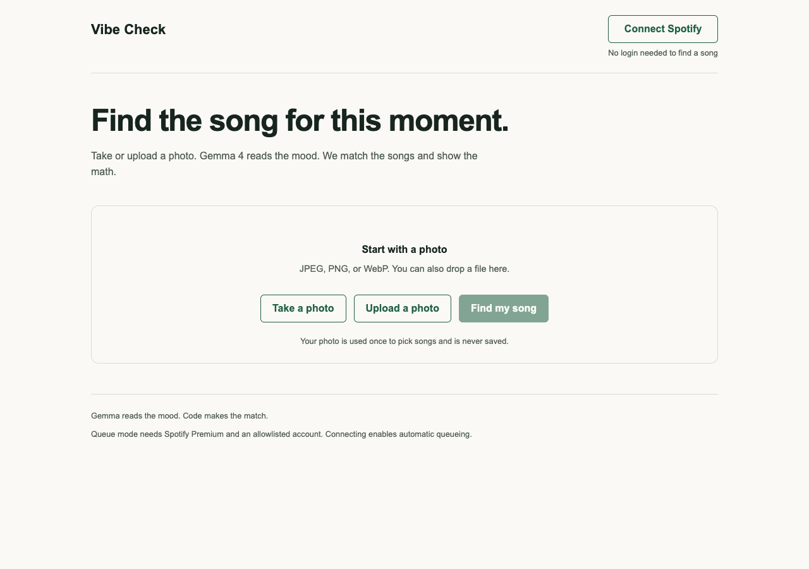
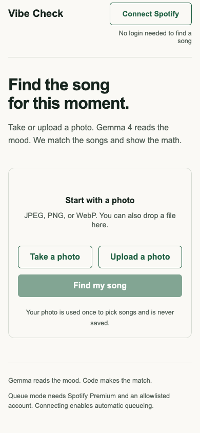
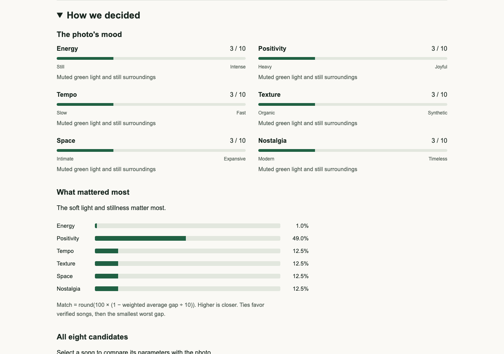

# Vibe Check

Pick a song for the mood of a photo, then see exactly why it won.

[Open the app](https://vibe-check-three-nu.vercel.app)

Take a photo or upload a JPEG, PNG, or WebP. Gemma 4 describes the visible mood, scores six parameters, and suggests eight real songs. Our code scores and ranks those songs. Spotify search verifies which tracks exist. Anyone can explore the results without logging in. An allowlisted Spotify Premium user can connect to add the winning verified song to their queue automatically.

The base implementation is deployed. Live Gemma inference and Premium queue delivery still require configured Vercel credentials and a live smoke test. Deterministic tests cover those service boundaries with controlled responses.

## Why we built it

A photo can capture a feeling that is hard to describe in a search box. Vibe Check makes one musical choice and exposes its reasoning instead of returning an unexplained list. We are building it for Hacktoberfest 2026's Best Use of Gemma 4 category.

Gemma 4 is central to the app. Its image understanding supplies the scene evidence and mood profile. Its musical estimates let us compare songs without Spotify audio-feature endpoints. The ranking remains ordinary, inspectable TypeScript. Google documents both supported model IDs in [Gemma on the Gemini API](https://ai.google.dev/gemma/docs/core/gemma_on_gemini_api).

## Run the app locally

Use Node.js 22.12 or newer in the Node.js 22 line, or a current supported Node.js LTS release.

```sh
npm ci
npm run dev
```

Open `http://127.0.0.1:3000`. The page works without service credentials. Submitting a photo reports that matching is not configured until the server has a Gemini API key. Tests use controlled upstream responses and need no credentials.

```sh
npm test
npm run lint
npm run typecheck
npm run build
```

## Configure Vercel

1. Import this repository into Vercel with the Next.js preset and a Hobby project.
2. Add the following variables to the project's server environment. Use a Gemini API project with the free tier and no paid billing upgrade.
3. Redeploy after changing environment variables.
4. In the Spotify developer dashboard, register the exact callback URL for the deployed origin. This deployment uses `https://vibe-check-three-nu.vercel.app/spotify/callback`.
5. Add the Premium teammate to the Spotify app's user allowlist.
6. Open Spotify on a device and start playback before testing queue mode.

| Variable | Value and use |
| --- | --- |
| `GEMINI_API_KEY` | Gemini API key, used only in the server Gemma adapter. |
| `GEMMA_MODEL` | `gemma-4-26b-a4b-it`. Optional because the same model is the code default. Switch to `gemma-4-31b-it` when needed. |
| `SPOTIFY_CLIENT_ID` | Spotify developer app client ID. The server also exposes this public identifier to the browser for PKCE. |
| `SPOTIFY_CLIENT_SECRET` | Spotify developer app client secret. Server search only. Never sent to the browser. |

Keep secret values in Vercel settings. Do not put them in source files, screenshots, issue reports, or chat. No `NEXT_PUBLIC_` secret variables are needed. The app does not need a database, storage bucket, paid AI gateway, or app account service.

Vercel Hobby and Gemini's free quota bound the available capacity. Quota exhaustion shows a retry message and does not switch to a paid provider. Queue mode depends on an existing Spotify Premium account. Spotify documents its Development Mode restrictions in the [migration guide](https://developer.spotify.com/documentation/web-api/tutorials/february-2026-migration-guide).

## How the match works

Every score is an integer from 0 to 10.

| Parameter | 0 | 10 | Default weight |
| --- | --- | --- | --- |
| Energy | Still | Intense | 0.25 |
| Positivity | Heavy | Joyful | 0.25 |
| Tempo | Slow | Fast | 0.15 |
| Texture | Acoustic or organic | Electronic or synthetic | 0.15 |
| Space | Intimate | Expansive | 0.10 |
| Nostalgia | Modern | Retro or timeless | 0.10 |

Gemma returns a photo score with visual evidence for every parameter, the six weights and their reason, and eight candidate song profiles. A normal request makes one generation call. JSON fences are removed before Zod validation. Only unusable output permits one additional call. Quota and network errors do not trigger another generation. The SDK's automatic retries are disabled.

Code clamps scores to 0–10 and rounds them to integers. It floors each raw weight at 0.05, then normalizes the weights to sum to one. Missing or invalid weights use the defaults above.

```text
parameter_gap[p] = abs(photo[p] - song[p])
distance = sum(weight[p] * parameter_gap[p])
match = round(100 * (1 - distance / 10))
```

A perfect match scores 100. Opposite profiles score 0. Candidates sort by this rounded score, then verified Spotify status, then the smallest largest parameter gap. Remaining ties preserve the original candidate order.

The winner is the highest-ranked verified song. A higher-ranked unverified song remains visible with its score and a Spotify search link. When every search fails, all eight suggestions remain available and nothing is queued.

Song scores are Gemma 4's estimates of how each song sounds, not measured audio data.

## Spotify has two independent modes

Basic mode uses server Client Credentials to search for each candidate in parallel. Each search uses `type=track`, `limit=1`, and market `US`. The app token stays in server memory until expiry. A verified result must match the requested title and artist after text normalization. Version differences can therefore leave a song unverified. Any token, network, quota, parsing, or search failure produces a locally constructed Spotify search link.

Queue mode uses [Authorization Code with PKCE](https://developer.spotify.com/documentation/web-api/tutorials/code-pkce-flow) in a popup. Allow popups for the app. The browser requests `user-modify-playback-state` and `user-read-playback-state`. Its verifier, state, and access token stay in memory. Refreshing the page disconnects Spotify. Expiry or a 401 asks you to reconnect.

The browser sends the verified winner URI directly to [Spotify's queue endpoint](https://developer.spotify.com/documentation/web-api/reference/add-to-queue). There is one automatic attempt per result. A manual button supports retry or adding another verified candidate. A timeout can have an unknown outcome. Check the Spotify queue before retrying because Spotify does not provide an idempotency key for this operation.

A 404 asks you to open Spotify and press play. A 403 explains the Premium and allowlist requirement. Anonymous visitors can still see the full analysis and verified track embed.

## Privacy

The browser resizes the photo to a maximum of 768 pixels on its longest side and re-encodes it as JPEG. The server validates and re-encodes the JPEG before passing it inline to Gemma. It does not use Google's persistent file-upload API. Vibe Check does not save or log photos, prompts, model output, or user tokens. Results and photo previews stay in memory and disappear on reload or reset. No analytics or database is installed.

The no-storage promise describes Vibe Check's own code. Google's processing is governed separately by the [Gemini API terms](https://ai.google.dev/gemini-api/terms). Google's [pricing page](https://ai.google.dev/gemini-api/docs/pricing) states that free-tier content can be used to improve its products. Do not interpret app-side deletion as a guarantee of zero provider retention. Spotify embeds also make requests to Spotify.

The Gemma prompt forbids identifying people or commenting on their appearance, age, gender, or personal traits. It asks for scene, color, light, setting, and mood evidence instead. This is a model instruction, not a guarantee that generated text can never violate it.

## Verify the browser flow

`scripts/browser-smoke.js` is a browser-console expression for the running app. Run it on a fresh home page at desktop and mobile viewport sizes. It creates a synthetic image in memory and replaces only the recommendation response with a deterministic fixture. It checks JPEG resizing, eight candidates, weights, winner selection display, comparison, viewport defaults, overflow, reset, and file errors. It restores `fetch` afterward. It does not validate live provider access.

The optional `scripts/capture-docs.mjs` runner uses Playwright to rerun the smoke checks and regenerate documentation screenshots. Install Playwright separately if you need to regenerate them. `VIBE_CHECK_URL` selects the app origin. `VIBE_CHROME_PATH` optionally selects an installed Chrome executable.

The test suite checks the pure ranker, real image decoding, actual route coordination, model retry boundaries, server Spotify fallbacks and caching, browser PKCE origin/source/state handling, token expiry, and queue status errors.

For the live acceptance test, upload a photo on the deployed URL without signing in. Confirm eight songs, evidence, weights, gaps, and a verified winner. Then connect the allowlisted Premium account with an active device, submit a new photo, and confirm both the success line and the song in the actual Spotify queue.

[Implementation and verification notes](docs/implementation-plan.md) and the [decision trail](docs/decisions.tsv) record current limits.

## Screenshots

The base layout intentionally stays minimal. These captures use the actual running UI. The results capture uses the deterministic browser fixture and does not claim a live Gemma result.







## License

[MIT](LICENSE).
