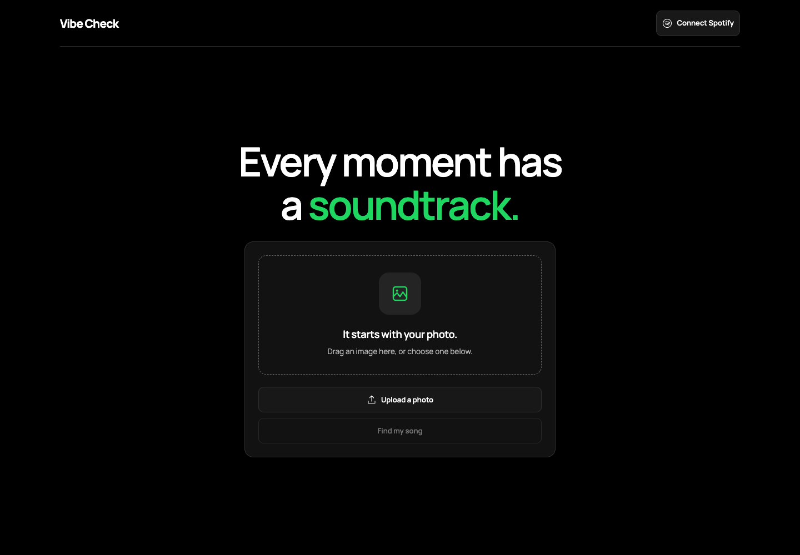
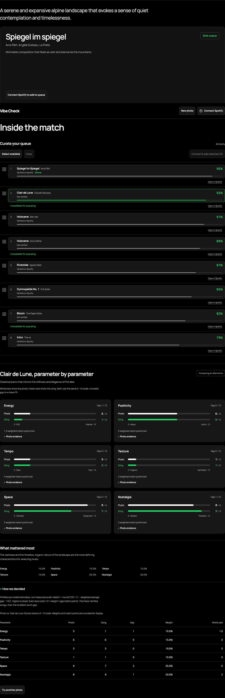

# Vibe Check

**Give your photo a soundtrack. See why the song fits.**

You have a photo of rain against a window or a beach after everyone has left. You want a song that fits the feeling, but you do not know what to search for.

Vibe Check starts with the photo. Gemma 4 reads its mood and suggests eight songs. The app compares their musical profiles, checks Spotify for matching recordings, and shows you how each song earned its place. Connect Spotify to send the best verified match straight to your queue.

[Try Vibe Check](https://vibe-check-three-nu.vercel.app) · [Run locally](#run-locally) · [How matching works](#how-matching-works)



## Built for the hackathon

Vibe Check is built for Hacktoberfest 2026's Best Use of Gemma 4 category.

Choosing music for a photo can mean searching genres, skipping tracks, and trying to put a feeling into words. Vibe Check uses the photo itself as the search input and explains the recommendation.

Gemma handles the interpretation. It describes the scene's mood, explains the visible evidence, chooses which mood dimensions matter most, and estimates the musical profiles of eight real songs. TypeScript handles the ranking. Spotify checks whether the suggested recordings exist and supplies playback links.

The comparison shows which dimensions helped a song match and which lowered its score. You can also choose another song and compare its scores against the same photo.

## Try the demo

1. Open the [app](https://vibe-check-three-nu.vercel.app). You can get recommendations without signing in.
2. Upload a JPEG, PNG, or WebP, or drag an image onto the page.
3. Choose **Find my song**. Gemma analyzes the photo, and the app returns eight ranked suggestions.
4. Choose a song to inspect its six mood scores, the photo evidence, and the weights behind its match score.
5. To queue music, connect an allowlisted Spotify Premium account with an active playback device. The top verified match queues automatically when Spotify is already connected. You can also select several verified songs and add them in ranked order.

For a judging walkthrough, use two photos with visibly different settings. Compare the mood profiles, inspect a lower-ranked song, then explain which weighted gaps lowered its score.

These screenshots come from the [live Vercel app](https://vibe-check-three-nu.vercel.app/), captured on October 24, 2026. A landscape photo produced eight song suggestions and five verified Spotify recordings. The top match was "Spiegel im spiegel" at 95%. The results below use the actual service response.

<details>
<summary>See the live song ranking and mood comparison</summary>



</details>

<details>
<summary>See the current mobile layout</summary>


</details>

## How matching works

The photo and every song share six scores, each an integer between 0 and 10.

| Dimension | At 0 | At 10 | Default weight |
| --- | --- | --- | --- |
| Energy | Still | Intense | 25% |
| Positivity | Heavy | Joyful | 25% |
| Tempo | Slow | Fast | 15% |
| Texture | Organic | Synthetic | 15% |
| Space | Intimate | Expansive | 10% |
| Nostalgia | Modern | Timeless | 10% |

Gemma provides visual evidence for each photo score and adjusts the weights for that particular scene. The app clamps scores to the allowed range, rounds them to integers, and normalizes the weights. Invalid or missing weights use the defaults above.

For each candidate, the ranker calculates the gap between the photo and song on every dimension.

```text
gap[dimension] = abs(photo[dimension] - song[dimension])
distance = sum(weight[dimension] * gap[dimension])
match = round(100 * (1 - distance / 10))
```

A song with the same profile scores 100. Opposite profiles score 0. For example, an energy gap of 2 at a 25% weight costs 5 match points. The comparison view exposes these contributions so you can trace the result.

Candidates sort by match score. Ties favor verified Spotify recordings, then the smallest worst gap, then the original candidate order. The highest-ranked verified song becomes the playback winner. A higher-scoring unverified suggestion keeps its rank and a Spotify search link. If no song can be verified, all eight suggestions remain visible and nothing queues.

A match score measures similarity between model-estimated profiles. It is not a probability that you will like the song. Song profiles are Gemma's estimates, not measured audio features.

## What runs where

| Part | Responsibility |
| --- | --- |
| Next.js 16, React 19, and Motion | Photo input, animated results, song selection, and mood comparisons |
| Gemma 4 through the Google Gen AI SDK | Photo interpretation, visual evidence, weights, and eight candidate song profiles |
| TypeScript and Zod | Response validation, normalization, and deterministic ranking |
| Sharp | Server-side image decoding and JPEG re-encoding |
| Spotify Web API | Track search, verified playback links, and queue delivery |
| Vercel | App and API hosting |
| Vitest | Ranking, image, provider, route, and browser authentication tests |

The browser resizes the photo and sends it to `/api/recommend`. The route validates the image, calls Gemma, searches Spotify for the candidates in parallel, and ranks the results. The browser renders the analysis and sends authorized queue requests directly to Spotify.

A normal analysis makes one generation request. Invalid model output permits one additional attempt within a shared 100-second deadline. Network and quota errors return a message without another generation attempt.

Start with [the mood model and ranker](src/lib/mood.ts), [the recommendation route](src/app/api/recommend/route.ts), or [the architecture notes](docs/architecture.md) to read the implementation.

## Run locally

Use Node.js 22.12 or newer within the Node.js 22 release line.

```sh
npm ci
```

Create `.env.local` in the repository root and add your service credentials.

```dotenv
GEMINI_API_KEY=your_gemini_api_key
GEMMA_MODEL=gemma-4-26b-a4b-it
SPOTIFY_CLIENT_ID=your_spotify_client_id
SPOTIFY_CLIENT_SECRET=your_spotify_client_secret
```

`GEMMA_MODEL` is optional. The app defaults to `gemma-4-26b-a4b-it`. The Gemini key enables photo analysis. The Spotify client ID and secret enable server-side track verification. Without Spotify credentials, recommendations still include search links, but songs cannot become verified queue targets.

Environment files are ignored by Git. Keep credentials on the server. The app exposes the public Spotify client ID for browser authentication, but never the client secret.

```sh
npm run dev
```

Open [the local app](http://127.0.0.1:3000). Without a Gemini key, the interface loads, but photo submission reports that matching is not configured. There is no database or storage service to set up.

### Connect Spotify

Register the exact app origin followed by `/spotify/callback` as a redirect URI in your Spotify developer app. For the local URL above, use `http://127.0.0.1:3000/spotify/callback`.

Add the Premium account you will use to the app's user allowlist. Open Spotify on a device and start playback before testing the queue. Allow the authentication popup in your browser.

Track search uses server Client Credentials and does not require visitor login. Queue mode uses Authorization Code with PKCE and requests `user-modify-playback-state` and `user-read-playback-state`. The browser keeps the access token in memory, so reloading disconnects the account.

A missing active device prompts you to open Spotify and press play. Authorization errors explain the Premium or allowlist requirement. If a queue request times out, check the Spotify queue before retrying. The request may have succeeded despite the timeout.

### Deploy on Vercel

Import the repository with the Next.js preset, add the same environment variables in the Vercel project settings, and deploy. Redeploy after changing environment variables.

Register your production callback URI in Spotify too. The linked deployment uses `https://vibe-check-three-nu.vercel.app/spotify/callback`.

## Verify the project

Run the automated checks without service credentials.

```sh
npm test
npm run lint
npm run typecheck
npm run build
```

The tests cover ranking and tie-breaking, image validation, model output parsing and retry limits, route coordination, Spotify search fallbacks, token caching, PKCE checks, token expiry, and queue errors. Provider tests use controlled responses.

For UI checks, run [the browser smoke expression](scripts/browser-smoke.js) in the console on a fresh app page at desktop and mobile widths. It creates a synthetic photo and substitutes a controlled recommendation response. It checks the upload, ranking, comparison, reset, and error flows, then restores `fetch`.

The optional [screenshot runner](scripts/capture-docs.mjs) uses Playwright to repeat the smoke checks and capture the interface. It requires a separate Playwright installation. Set `VIBE_CHECK_URL` to choose the app origin and `VIBE_CHROME_PATH` to use an installed Chrome executable.

On October 24, 2026, a photo submission to the deployed app returned HTTP 200 with eight Gemma-generated suggestions and five verified Spotify recordings. The screenshots above capture that run. Desktop and mobile upload screens were also checked on Vercel.

Premium queue delivery still needs a separate live check. Connect an allowlisted Premium account with active playback and confirm the recommended song in the device queue. The [implementation record](docs/implementation-plan.md) describes the earlier base checks. Its missing-credentials status predates this live inference check.

## Photos and privacy

The browser reduces the photo to at most 768 pixels on its longest side and converts it to JPEG. The server validates and re-encodes that image before sending it inline to Gemma. It does not use Google's persistent file-upload API.

Vibe Check does not save photos, prompts, model output, or user tokens, and does not write those values to application logs. Photo previews and results stay in memory and disappear when you reset or reload. The app has no database or analytics integration.

The model prompt asks for evidence about the scene, light, color, objects, and mood. It forbids identifying people or describing their appearance, age, gender, or personal traits. These are model instructions, not a guarantee about every generated response.

Google processes the uploaded image under its [Gemini API terms](https://ai.google.dev/gemini-api/terms). Free-tier processing can permit product improvement use. Check the provider's terms before uploading sensitive photos. The app's lack of storage does not imply zero provider retention. Spotify embeds also send requests to Spotify.

## License

[MIT](LICENSE).
